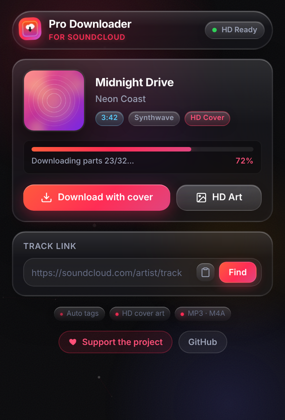
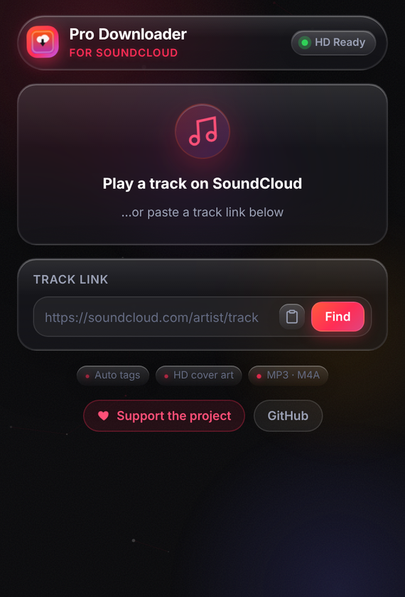
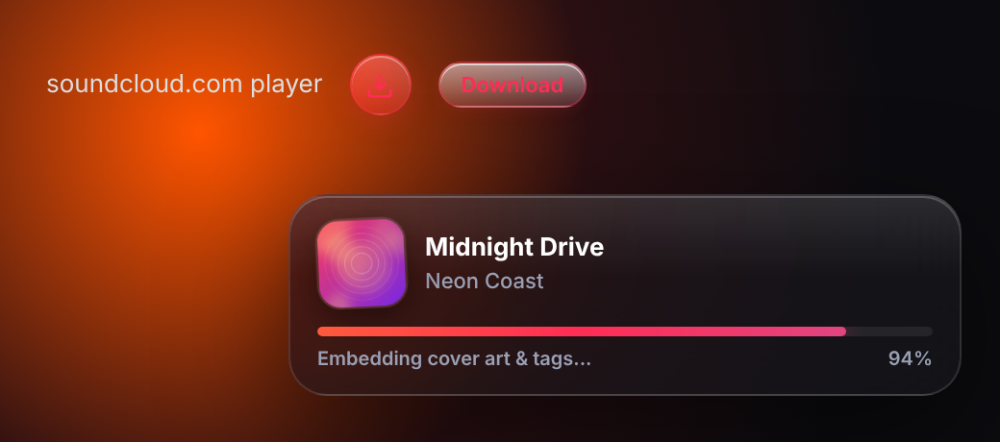

# Pro Downloader for SoundCloud

**Download SoundCloud tracks with HD cover art and full tags embedded — in one click.**

 &nbsp; 

---

## ✨ Features

- **One-click download right on soundcloud.com** — a button in the player bar and a **Download** button under every track
- **Cover art embedded automatically**
  - MP3 → ID3v2.3 tags + front cover
  - AAC streams → a regular, fully compatible **M4A** with iTunes-style tags + cover
- **Full metadata** — title, artist, album artist, genre, year, track link
- **HD artwork download** in original quality
- **Paste any track link** in the popup — no need to open the track
- Files show up correctly in **Windows Explorer, Apple Music, VLC, Android and car stereos**
- Liquid-glass interface with smooth animations
- No accounts, no tracking, no ads

## 📦 Install

1. **[Download the latest release](../../releases/latest)** (`.zip`) and unpack it — or clone this repo.
2. Open `chrome://extensions/` (Edge: `edge://extensions/`).
3. Turn on **Developer mode** (top-right switch).
4. Click **Load unpacked** and select the unpacked folder.
5. Pin the extension to the toolbar — done!

## 🎧 Usage

**On soundcloud.com** — start a track and press the download icon in the player bar, or the **Download** button under any track. Progress appears in the bottom-right corner.

**From the popup** — click the extension icon while a track is playing (or paste a link) and choose **Download with cover** or **HD Art**.

## 🛠 How it works

The extension resolves the track through SoundCloud's public web API, downloads the best open stream (progressive MP3 or HLS AAC), and assembles the file locally in your browser:

| Stream | Output | Tags |
|---|---|---|
| MP3 | `.mp3` | ID3v2.3 (`TIT2`, `TPE1`, `TALB`, `TCON`, `TYER`, `COMM`, `APIC`) |
| HLS AAC (fMP4) | `.m4a` — remuxed into a regular MP4 | iTunes `ilst` (`©nam`, `©ART`, `aART`, `©alb`, `©gen`, `©day`, `covr`) |

Everything happens on your machine — nothing is uploaded anywhere.

## 💖 Support

If this extension saves you time, you can support development:

**[☕ Support on Boosty](https://boosty.to/mooooo111/donate)**

Starring the repo ⭐ helps a lot too!

## ⚠️ Disclaimer

- Tracks protected with DRM by the rights holder cannot be downloaded — the extension tells you when that's the case.
- Only download content you have the right to download, and respect artists and SoundCloud's Terms of Use.
- This project is **not affiliated with or endorsed by SoundCloud**.

## 🔒 Privacy

No analytics, no personal data collected. The extension talks only to SoundCloud's servers (`api-v2.soundcloud.com`, `sndcdn.com`). If a track has no open stream it may fall back to `soundclouddownloader.io`, sending only the public track URL. A cached public client ID is stored locally in `chrome.storage`.

## 📄 License

[MIT](LICENSE)
